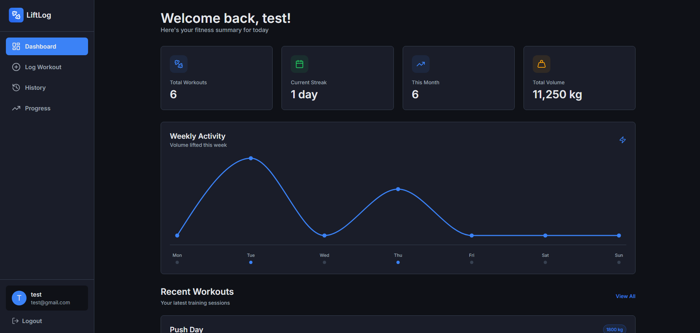
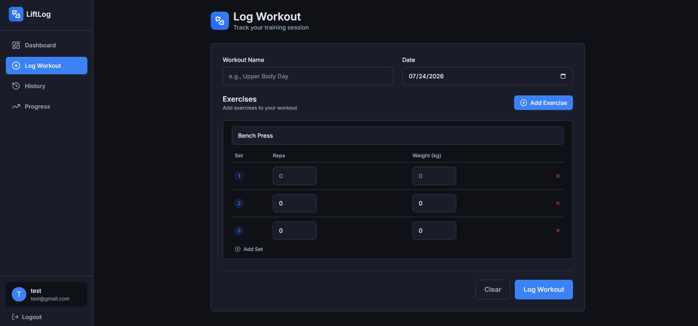
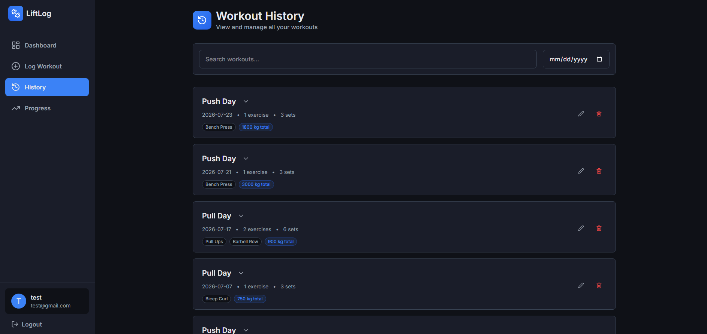
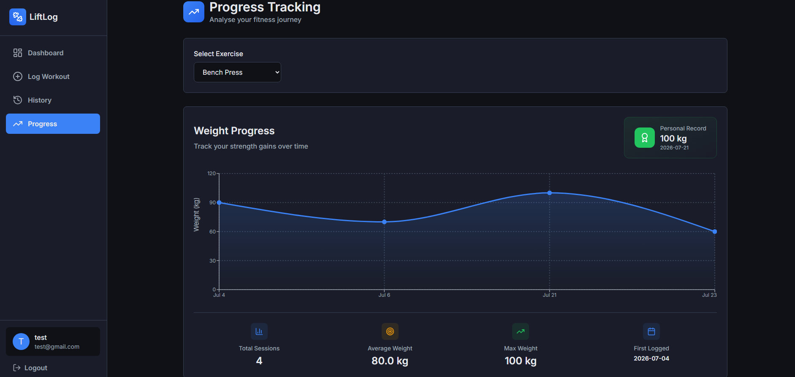
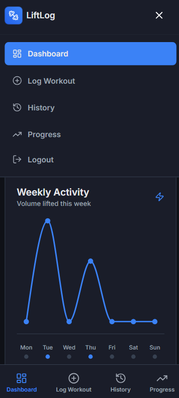

# LiftLog

A full-stack workout tracker for logging exercises, tracking progress and analysing training data.

**Live demo:** https://lift-log-phi-six.vercel.app/
**Repo:** https://github.com/Koraxdd/LiftLog

---

## TL;DR

LiftLog lets users log workouts with dynamic exercises and sets, review their history, and track strength progress over time through charts and personal records. Authentication uses hashed passwords, JWT sessions and middleware-protected routes.

**Core stack:** Next.js (App Router) · TypeScript · Prisma · PostgreSQL (Neon) · NextAuth · Tailwind CSS · Recharts · React Hook Form · Zod

---

## Features

### Workout Logging
Dynamic forms for adding exercises and sets, with a searchable exercise library and custom exercise creation.

### History
Browse, filter, edit and delete past workouts, with the full exercise and set breakdown for each session.

### Progress
Per-exercise strength charts, personal record display and session statistics.

### Dashboard
Total workouts, current streak, monthly activity, total volume lifted, a weekly activity chart, recent workouts and personal records.

### Auth and layout
Registration and login with Argon2 hashing, JWT sessions and middleware route protection. Mobile-first layout with a bottom navigation bar on phones and a sidebar on desktop.

---

## Tech Stack

| Layer | Choice |
| --- | --- |
| Framework | Next.js 15 (App Router, Server Components + Server Actions) |
| Language | TypeScript |
| Database | PostgreSQL (Neon), Prisma ORM |
| Auth | NextAuth.js v4 (JWT strategy), Argon2 |
| Forms | React Hook Form + Zod |
| Styling | Tailwind CSS v4 |
| Charts | Recharts |
| Deployment | Vercel |

---

## Getting Started

### Prerequisites

- Node.js 18+
- A PostgreSQL database (this project uses [Neon](https://neon.com))

### Setup

```bash
git clone https://github.com/Koraxdd/LiftLog
cd liftlog
npm install
```

Create `.env.local`:

```env
DATABASE_URL=
NEXTAUTH_SECRET=
NEXTAUTH_URL=http://localhost:3000
```

```bash
npx prisma migrate dev
npm run dev
```

---

## Architecture Notes & Decisions

- **Server Actions instead of a separate API.** Reads happen in Server Components and writes in Server Actions, so there's no client fetch layer to maintain.
- **Relational schema.** A workout contains ordered exercises, and each exercise contains ordered sets. Exercise templates are either global or owned by a user, so custom exercises never leak between accounts.
- **Route protection in middleware.** Unauthenticated users are redirected before a page renders, and server-side checks still run on data access.

---

## Screenshots

**Dashboard**

<p align="center">  </p>

**Log Workout**

<p align="center">  </p>

**History**

<p align="center">  </p>

**Progress**

<p align="center">  </p>

**Mobile**

<p align="center">  </p>